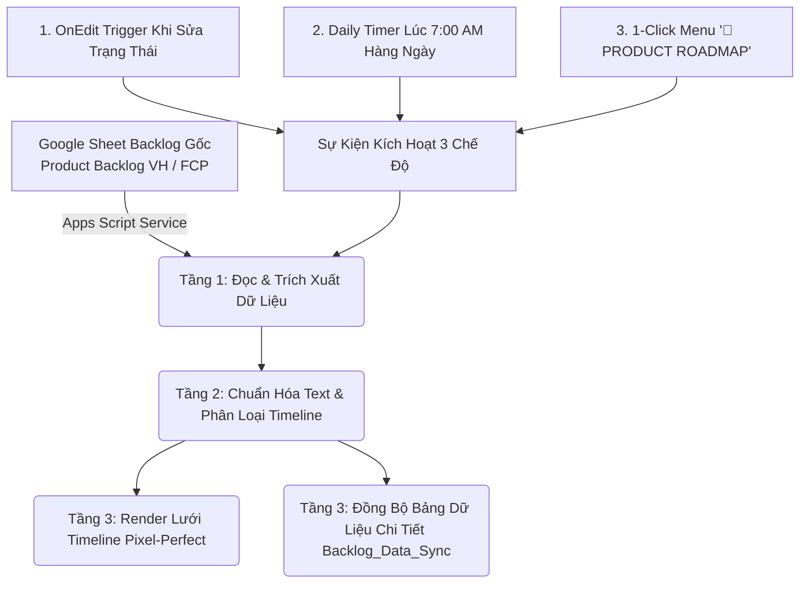

# BỘ KỸ NĂNG PRODUCT ROADMAP & REALTIME SYNC ENGINE (SKILL-ROADMAP)

> **Mã hiệu vai trò**: `PO-ROADMAP-FTEL`  
> **Áp dụng cho**: Product Owner (PO), Technical Product Manager (TPM), Senior Business Analyst (BA)  
> **Dự án**: Website FPT.vn, CMS Quản trị Nội dung, Hệ sinh thái số FPT Telecom  
> **Nền tảng triển khai**: Google Sheets + Google Apps Script Realtime Engine  

---

## 1. TỔNG QUAN & SỨ MỆNH CỦA PRODUCT OWNER

Product Roadmap không chỉ là một bảng tiến độ, mà là **bản đồ chiến lược định hướng toàn bộ nguồn lực công nghệ và kinh doanh** của sản phẩm trong từng giai đoạn (Quý/Năm). 

Một Product Roadmap đạt chuẩn cao cấp tại FPT Telecom phải giải quyết đồng thời 3 bài toán:
1. **Truyền thông Chiến lược (Executive Communication)**: Ban Giám đốc và Stakeholders nhìn vào có thể nắm bắt ngay bức tranh toàn cảnh, tiến độ từng phân hệ (Web, CMS, Giỏ hàng, Bán chéo) chỉ trong 30 giây.
2. **Nhận Diện Thương Hiệu Chuyên Nghiệp (Brand Identity)**: Thiết kế chuẩn xác theo nhận diện FPT (Banner màu cam `#F37021`, Logo FPT Telecom sắc nét, 3 màu tháng Xanh - Tím - Xanh lá, Thẻ task Pastel êm dịu, Font Times New Roman chuẩn tài liệu FPT).
3. **Đồng Bộ Dữ Liệu Tự Động 100% (Realtime Automation)**: Không nhập tay thủ công; mọi thay đổi trạng thái, ưu tiên, mô tả từ file Google Sheet Backlog gốc đều tự động phản ánh tức thì lên Roadmap Timeline.

---

## 2. CẤU TRÚC BỘ KỸ NĂNG TRONG `skill-roadmap`

```
skill-po/roadmap/
├── SKILL.md                                     # Cổng hướng dẫn toàn diện vai trò PO & Roadmap Engine
├── scripts/
│   └── roadmap_sync_engine_template.js          # Mã nguồn Google Apps Script chuẩn chỉnh nhất
├── templates/
│   └── roadmap_sheet_spec.md                    # Đặc tả kích thước, lưới 12 cột, chiều cao dòng pixel-perfect
└── references/
    └── status_matrix.md                         # Bảng mã màu 8 mốc trạng thái, % tiến độ, tỷ lệ thanh đáy 6px
```

---

## 3. QUY CHUẨN THIẾT KẾ VISUAL PRODUCT ROADMAP (PIXEL-PERFECT SPEC)

### A. Quy Chuẩn Lưới 12 Cột & Tỷ Lệ Toàn Bảng
* **Tổng chiều rộng**: **1.740 px** ($12 \text{ cột} \times 145\text{px/cột}$). Vừa vặn 100% màn hình Desktop chuẩn ở mức thu phóng 100%, không bị thanh cuộn ngang khó chịu.
* **Phân bổ 3 Tháng**:
  - **Tháng thứ nhất (Tháng 10)**: Cột 1 đến 4 (W1 - W4) ➔ Màu Header Xanh dương đậm (`#1E40AF`).
  - **Tháng thứ hai (Tháng 11)**: Cột 5 đến 8 (W1 - W4) ➔ Màu Header Tím đậm (`#6B21A8`).
  - **Tháng thứ ba (Tháng 12)**: Cột 9 đến 12 (W1 - W4) ➔ Màu Header Xanh lá đậm (`#047857`).
* **Đóng khung bảng gọn gàng**: Tự động xóa sạch các cột thừa từ Cột 13 trở đi (`deleteColumns(13, ...)`).

### B. Banner Tiêu Đề Dòng 1 (Màu Cam FPT Telecom & Logo Chuẩn Kích Thước)
* **Màu sắc nền**: Màu Cam nhận diện thương hiệu FPT Telecom chuẩn (`#F37021`).
* **Chiều cao**: Cố định chính xác **32 px** (đảm bảo không bị quá to, giữ nguyên tỷ lệ thẩm mỹ của bảng tính).
* **Chữ Tiêu Đề**: `FPT TELECOM — PRODUCT ROADMAP QUÝ X/202X (TÊN DỰ ÁN)`, chữ Trắng (`#FFFFFF`), cỡ chữ 14pt Bold, Font Times New Roman, căn giữa hoàn hảo.
* **Tích hợp Logo FPT Telecom**:
  - Logo FPT Telecom được thiết kế sẵn d   - Text 2 dòng RichText chuyên nghiệp:
     - Dòng 1: `[Hệ thống] Tên Task` (Font Times New Roman 10pt Bold):
       * `[CMS]`: **Màu Xanh dương đậm (`#1E40AF`)**
       * `[Web]`: **Màu Xanh lá đậm (`#047857`)**
       * Đa hệ thống (`[CMS, Web]` / `[Web, CMS]`): Tô độc lập từng từ `CMS` (xanh dương đậm) và `Web` (xanh lá đậm)
       * Tên Task: Màu đen sắc nét (`#1E293B`)
     - Dòng 2: `Detail (Acceptance Criteria / Mô tả)` (Font Times New Roman 8.5pt Italic, màu xám xanh `#475569`).
   - Badge bên phải: Nhãn độ ưu tiên `[P1] / [P2]` (Đỏ / Cam) và Nhãn trạng thái `[DEV In Progress] / [UAT]` (Vàng / Tím).
   - **Tối ưu hiển thị text**: Mở rộng không gian hiển thị linh hoạt (Task 1 tháng: 85 ký tự; Task 2 tháng: 170 ký tự), tuyệt đối không để dấu ba chấm `...` khi diện tích thẻ còn trống.
2. **Dòng 2: Thanh Tiến Trình Đáy Thẻ (Chiều cao cố định 6px)**
   - Nằm ngay dưới đáy thân thẻ, mang màu **Accent đậm rực rỡ** của trạng thái tương ứng.
   - Chạy theo tỷ lệ % các cột của tuần:
     - Chưa tiếp nhận: 12.5% (Cột đầu tiên)
     - Đã tiếp nhận: 25.0% (1 cột)
     - Đang phân tích / Document: 37.5%
     - Transfer DEV / PO reviewed: 50.0% (Nửa thanh task)
     - DEV In Progress: 62.5%
     - UAT: 75.0% (3/4 thanh task)
     - **CHỈ DUY NHẤT `Done`**: Mới hiển thị full 100% màu toàn bộ cây task.
     - Các cột chưa đạt đến: Giữ màu nền Canvas xám nhẹ `#F8FAFC`.
3. **Dòng 3: Khoảng đệm (Spacer - 8px)**
   - Nền trống màu trắng, giúp các thẻ tách bạch rõ ràng, không dính chùm vào nhau.

---

## 4. BẢNG MA TRẬN 8 MỐC TRẠNG THÁI & MÃ MÀU CHUẨN

| Mốc Trạng thái | Tỷ lệ % | Màu Thân Thẻ (Pastel) | Màu Thanh Đáy (Accent 6px) | Màu Badge | Icon | Ý nghĩa PO |
|:---|:---:|:---:|:---:|:---:|:---:|:---|
| **Chưa tiếp nhận** | `12.5%` | `#F1F5F9` | `#94A3B8` | `#475569` | ⚪ | Ghi nhận Backlog, chưa xếp Sprint |
| **Đã tiếp nhận yêu cầu** | `25.0%` | `#DBEAFE` | `#3B82F6` | `#1D4ED8` | 🔵 | Đã tiếp nhận vào phạm vi Quý |
| **Đang phân tích/Document**| `37.5%` | `#FFEDD5` | `#F97316` | `#C2410C` | 🟠 | BA đang viết URD/BRD, làm UI/UX |
| **Transfer DEV/PO reviewed**| `50.0%` | `#FEE2E2` | `#EF4444` | `#941F10` | 🔴 | Chip màu hồng đào, PO duyệt bàn giao DEV |
| **DEV In Progress** | `62.5%` | `#FEF9C3` | `#EAB308` | `#A16207` | 🟡 | Đang code frontend/backend/API |
| **UAT** | `75.0%` | `#F3E8FF` | `#A855F7` | `#6B21A8` | 🟣 | Đang test Staging & Nghiệm thu |
| **Done** | `100.0%` | `#D1FAE5` | `#10B981` | `#047857` | ✅ | Deploy Production thành công |
| **Pending** | `0.0%` | `#F3F4F6` | `#9CA3AF` | `#6B7280` | ⏸️ | Đang tạm dừng chờ làm rõ |

---

## 4.1. QUY ĐỊNH MÀU SẮC CHO PHÂN HỆ HỆ THỐNG
* **CMS**: **Màu Xanh dương đậm (`#1E40AF`)**
* **Web**: **Màu Xanh lá đậm (`#047857`)**
* **Đa hệ thống**: Tô màu độc lập cho từng từ viết tắt để người xem dễ dàng phân biệt ngay trên timeline.

---

## 4. BẢNG MA TRẬN 8 MỐC TRẠNG THÁI & MÃ MÀU CHUẨN

| Mốc Trạng thái | Tỷ lệ % | Màu Thân Thẻ (Pastel) | Màu Thanh Đáy (Accent 6px) | Màu Badge | Icon | Ý nghĩa PO |
|:---|:---:|:---:|:---:|:---:|:---:|:---|
| **Chưa tiếp nhận** | `12.5%` | `#F1F5F9` | `#94A3B8` | `#475569` | ⚪ | Ghi nhận Backlog, chưa xếp Sprint |
| **Đã tiếp nhận yêu cầu** | `25.0%` | `#DBEAFE` | `#3B82F6` | `#1D4ED8` | 🔵 | Đã tiếp nhận vào phạm vi Quý |
| **Đang phân tích/Document**| `37.5%` | `#FFEDD5` | `#F97316` | `#C2410C` | 🟠 | BA đang viết URD/BRD, làm UI/UX |
| **Transfer DEV/PO reviewed**| `50.0%` | `#DCFCE7` | `#22C55E` | `#15803D` | 🟢 | PO duyệt spec, bàn giao DEV |
| **DEV In Progress** | `62.5%` | `#FEF9C3` | `#EAB308` | `#A16207` | 🟡 | Đang code frontend/backend/API |
| **UAT** | `75.0%` | `#F3E8FF` | `#A855F7` | `#6B21A8` | 🟣 | Đang test Staging & Nghiệm thu |
| **Done** | `100.0%` | `#D1FAE5` | `#10B981` | `#047857` | ✅ | Deploy Production thành công |
| **Pending** | `0.0%` | `#F3F4F6` | `#9CA3AF` | `#6B7280` | ⏸️ | Đang tạm dừng chờ làm rõ |

---

## 5. KIẾN TRÚC LUỒNG ĐỒNG BỘ TỰ ĐỘNG (REALTIME SYNC ENGINE)

Hệ thống hoạt động theo mô hình 4 tầng khép kín:



### Các Tính Năng Đồng Bộ Cốt Lõi:
1. **Lấy dữ liệu tự động từ Sheet gốc**:
   - Tự động nhận diện dòng tiêu đề và các cột: Trạng thái, Tên US/Đầu mục, Độ ưu tiên, Detail/Mô tả, PIC, Timeline.
2. **Làm sạch và tối ưu nội dung Detail**:
   - Tự động lọc bỏ các đường link URL dài dòng (`https://...`).
   - Xóa bỏ các tiền tố thừa: `Tài liệu:`, `Thiết kế:`, `-`.
   - Mở rộng độ dài hiển thị: Tự động tính toán theo số cột của task (85 ký tự cho task 1 tháng, 170 ký tự cho task vắt 2 tháng), đảm bảo toàn bộ ý nghĩa nghiệp vụ hiển thị trọn vẹn.
3. **Nhận diện chính xác Timeline vắt tháng**:
   - Task 1 tháng: Chiếm trọn 4 cột W1-W4 của tháng tương ứng (Tháng 10: Cột A-D; Tháng 11: Cột E-H; Tháng 12: Cột I-L).
   - Task vắt 2 tháng: Chiếm trọn 8 cột vắt ngang qua 2 tháng (Tháng 10 - Tháng 11: Cột A-H; Tháng 11 - Tháng 12: Cột E-L).
4. **Cơ chế kích hoạt 3 chế độ (Triple-Trigger)**:
   - **Chế độ 1 - Menu 1-Click**: Người dùng mở menu `🚀 PRODUCT ROADMAP` ➔ chọn `🔄 Đồng Bộ Backlog & Đổi Màu Thanh Task Theo Trạng Thái`.
   - **Chế độ 2 - Realtime OnEdit**: Khi PO/BA chỉnh sửa trạng thái tại sheet phụ `Backlog_Data_Sync`, hệ thống lập tức cập nhật lại màu thanh task trên Roadmap.
   - **Chế độ 3 - Daily Cron**: Lập lịch tự động chạy ngầm mỗi sáng lúc 7:00 AM trước giờ làm việc.

---

## 6. HƯỚNG DẪN TRIỂN KHAI STEP-BY-STEP CHO PRODUCT OWNER

### Bước 1: Chuẩn bị Google Spreadsheet
1. Mở file Google Sheet Roadmap của dự án.
2. Đổi tên sheet chính thành `Roadmap_Timeline_Q4`.
3. Tạo thêm một sheet phụ mang tên `Backlog_Data_Sync` (để lưu dữ liệu tra cứu và hỗ trợ chỉnh sửa nhanh).

### Bước 2: Cài đặt Google Apps Script
1. Trên Google Sheets, vào menu **Tiện ích mở rộng** (Extensions) ➔ chọn **Apps Script**.
2. Sao chép toàn bộ mã nguồn mẫu tại file:
   [roadmap_sync_engine_template.js](file:///Users/hathuy/Documents/FPT-1/.agent/skills/skill-po/roadmap/scripts/roadmap_sync_engine_template.js)
3. Dán vào file `Mã.gs` trong trình soạn thảo Apps Script.
4. Điều chỉnh 2 hằng số liên kết nguồn ở đầu file:
   - `SOURCE_SPREADSHEET_ID`: ID của file Google Sheet Product Backlog gốc.
   - `SOURCE_GID`: GID của trang tính Backlog nguồn.
5. Nhấn **Lưu dự án** (Ctrl+S / Cmd+S).

### Bước 3: Chạy khởi tạo và Cấp quyền
1. Trên thanh công cụ Apps Script, chọn hàm `syncRoadmapFromBacklog` ➔ nhấn nút **Chạy** (Run).
2. Khi Google yêu cầu cấp quyền truy cập: Nhấn *Xem lại quyền* ➔ Chọn tài khoản ➔ Nhấn *Nâng cao* ➔ Chọn *Đi tới dự án (không an toàn)* ➔ Nhấn *Cho phép*.
3. Đợi 5-8 giây để hệ thống tự động hoàn tất việc tạo khung timeline và dựng các thanh task.

### Bước 4: Thiết lập Lịch Đồng Bộ Tự Động Hàng Ngày
1. Trên Google Sheets, làm mới trang (F5).
2. Menu `🚀 PRODUCT ROADMAP` sẽ xuất hiện trên thanh công cụ.
3. Nhấp vào menu `🚀 PRODUCT ROADMAP` ➔ Chọn `⏰ Cài Đặt Tự Động Đồng Bộ Mỗi Ngày (7:00 AM)`.

---

## 7. CHECKLIST NGHIỆM THU DÀNH CHO PO (ACCEPTANCE CHECKLIST)

Trước khi gửi Product Roadmap cho Ban Giám đốc hoặc trình bày tại cuộc họp Sprint Planning, PO cần kiểm tra các tiêu chí sau:

- [ ] **Banner Tiêu Đề**: Dòng 1 có màu Cam FPT (`#F37021`), Logo FPT Telecom hiển thị sắc nét bên góc trái, chiều cao cố định 32px, không bị to hay vỡ layout.
- [ ] **Tiêu đề Tháng**: Tháng 10 (Xanh dương), Tháng 11 (Tím), Tháng 12 (Xanh lá) phân chia rõ 4 cột/tháng.
- [ ] **Thân thẻ Task**: Sử dụng đúng màu Pastel cấp độ 100 theo trạng thái, chữ Times New Roman 10pt Bold rõ ràng.
- [ ] **Nội dung Detail**: Đã được tối ưu hoá, hiển thị trọn vẹn Acceptance Criteria, không bị dấu `...` khi ô còn trống.
- [ ] **Thanh tiến trình 6px**: Chạy đúng tỷ lệ % theo mốc trạng thái; chỉ có task `Done` mới phủ kín 100% màu.
- [ ] **Không tràn viền**: Toàn bộ bảng nằm gọn trong 12 cột (1.740px), các cột từ 13 trở đi đã được xóa sạch.
- [ ] **Dòng Footer**: Hiển thị nguồn dữ liệu ngắn gọn: `Nguồn: Backlog Website & CMS FPT.vn (Q4/2026)`.
- [ ] **Cơ chế tự động**: Menu `🚀 PRODUCT ROADMAP` hoạt động trơn tru khi click đồng bộ.
